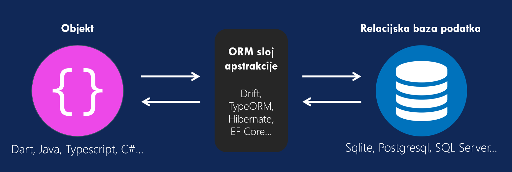
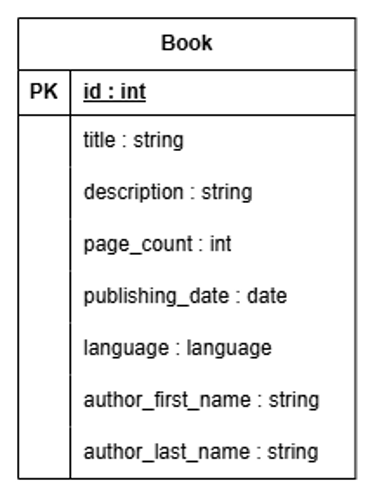
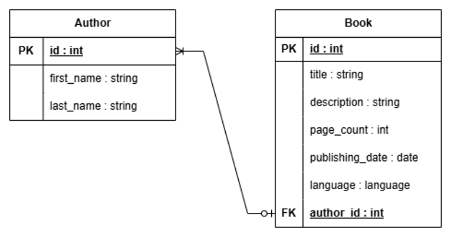
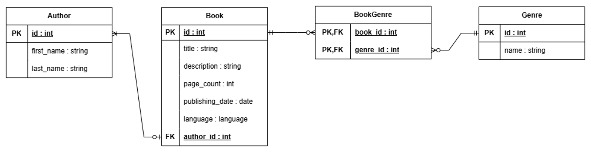
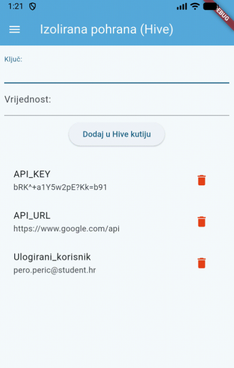

# Korištenje lokalne baze podataka i drugih mehanizama pohrane podataka u Flutter-u

Ovaj README predstavlja tutorial za Flutter projekt koji prolazi kroz lokalnu pohranu u Flutteru s pomoću SQLite i Drift ORM-a te izoliranu pohranu s pomoću Hive_ce.

**Preduvjeti:** osnovno poznavanje Fluttera i načina rada relacijskih baza

---

**Autor:** Šimun Ćosić

**Kolegij:** Razvoj aplikacija za mobilne i pametne uređaje

## Sadržaj

1. Uvod u lokalnu pohranu
2. Osnove ORM-a
3. Drift i definicije osnovnih elemenata
4. CRUD operacije
5. Spajanja
6. Verzioniranje i migracija baze
7. Izolirana pohrana i Hive_ce

## 1. Uvod u lokalnu pohranu

### Prednosti lokalne pohrane

- Bolje performanse od udaljene baze na manjem skupu podataka
- Podaci neće biti otkriveni ako se dogodi curenje podataka s poslužitelja
- Nije potrebna internetska veza
- Većinom se govori o jednostavnijim mehanizmima za pohranu podataka

### Nedostaci lokalne pohrane

- Podaci se ne sinkroniziraju automatski između uređaja
- Postoji rizik gubitka podataka pri brisanju aplikacije ili kvara uređaja
- U slučaju višeplatformskog razvoja potrebno je osigurati da lokalni mehanizam pohrane radi na svakom namijenjenom sustavu

## SQLite

- Najkorištenija relacijska baza podataka na mobilnim uređajima
- Sprema se lokalno na uređaju u jednoj datoteci (.db, .sqlite)
- Nije potrebno imati instaliranu i pokrenutu instancu baze podataka
- Mogućnost čitanja s pomoću Flutter DevTools i SQLite Viewer ekstenzije
- Najnovija verzija je SQLite 3.54.1

## 2. Osnove ORM-a

**Object Relational Mapping (ORM)** je tehnika koja povezuje objekte s tablicama u relacijskoj bazi.

- Piše se u namjenskom programskom jeziku umjesto u sirovom SQL-u.
- Pristupi:
  - *Database-first* - prvo postoji baza te se klase generiraju na temelju nje
  - *Model-first* - prvo se izrađuje model u predviđenom programu te na temelju njega generiraju klase
  - *Code-first* - prvo se pišu klase u kodu te se baza generira na temelju njih
- Jedan od najpopularnijih ORM-ova za Flutter je **Drift**.



## 3. Drift i definicije osnovnih elemenata

Drift je ORM otvorenog koda koji predstavlja sloj apstrakcije nad SQLite bazom podataka.

- Osnovne klase: **tablice**, **DAO** i **baza podataka**
- Podržava reaktivno osvježavanje korisničkog sučelja (`Stream<T>` i `watch`)
- Zavisni paketi: `drift`, `drift_flutter`, `path_provider`, `drift_dev`, `build_runner`
- Omogućuje da se tablice opisuju Dart klasama, a upiti pišu Dart kodom umjesto sa SQL-om.

### 3.1 Postavljanje projekta

**pubspec.yaml**

```yaml
name: flutter_local_storage_seminar
description: >
  Seminarski rad na temu flutter
  mehanizama za lokalnu pohranu
publish_to: 'none'
version: 0.1.0+1

environment:
  sdk: ^3.13.5

dependencies:
  drift: ^2.35.2
  drift_flutter: ^0.3.1
  flutter:
    sdk: flutter
  intl: ^0.20.3
  path: ^1.9.0
  path_provider: ^2.1.5

dev_dependencies:
  flutter_test:
    sdk: flutter
  flutter_lints: ^6.0.0

  drift_dev: ^2.35.2
  build_runner: ^2.17.1

flutter:
  uses-material-design: true
```

`drift` i `drift_flutter` su sam ORM, `path_provider` i `path` služe za pronalazak direktorija i spajanje putanje do datoteke baze, a `intl` za formatiranje datuma. `drift_dev` i `build_runner` generiraju kod te su potrebni samo tijekom razvoja.

Za postavljanje paketa je potrebno psotaviti pakete u `pubspec.yaml` i pokrenuti naredbu `flutter pub get`.

### 3.2 Normalizacija

Normalizacija je proces organizacije podataka u bazi kako bi se smanjilo ponavljanje (redundancija) i poboljšao integritet podataka.

| Normalna forma | Definicija |
| --- | --- |
| **1NF** | Svaki stupac sadrži atomske (nedjeljive) vrijednosti. Nema ponavljajućih grupa podataka. |
| **2NF** | Zadovoljava 1NF i svi neključni atributi ovise o cijelom primarnom ključu (nema djelomične ovisnosti). |
| **3NF** | Zadovoljava 2NF i nema tranzitivnih ovisnosti (neključni atributi ne ovise o drugim neključnim atributima). |

Primjer: tablica `Book` je sadržavala atribute `author_first_name` i `author_last_name`. Normalizacijom se oni izdvajaju u zasebnu tablicu `Author`, a `Book` na nju upućuje vanjskim ključem `author_id`. Pokriva 1NF zato jer nema popisa vrijednosti u jednoj ćeliji, 2NF zato jer svaki stupac ovisi o cijelom ključu i 3NF zato jer stupci ne ovise o nekom neključnom stupcu.

Entitet `Book` koji nije normaliziran jer sadržava podatke o autoru koji nisu jedinstveni za njega:



Normalizirani entitet `Book` na entitet `Autor` koristeći normalne forme:



### 3.3 Definicija normaliziranih tablica u Drift-u

- Svaka tablica u Driftu se definira kao klasa koja nasljeđuje Drift klasu `Table`.
- Potrebno je postaviti `getter` koji vraća odgovarajući tip.
- Ulančavanje svojstva stupca:
  - `.autoIncrement()` - postavlja stupac da automatski povećava vrijednost za 1
  - `.check()` - postavlja uvjet koji vrijednost mora zadovoljiti (ovdje postavlja da broj stranica mora biti veći od 0)
  - `.unique()` - zabranjuje duplikate u stupcu
  - `.nullable()` - omogućuje da vrijednost bude `null`
  - `.named()` - eksplicitno postavlja naziv stupca, iako će on automatski postaviti naziv stupca u bazi na **snake case** (primjer. firstName -> first_name)
  - ...
- Specifičnost Drifta je završetak definicije stupaca s `()()`, na kraju se dodaje dodatni `()` tako da se označi da je kraj definicije tog stupca.
- `textEnum<T>()` sprema Dart enumeraciju kao tekst u bazu, `intEnum<T>()` kao broj
- Iz klase `Author` generiraju se objekti `AuthorData` (predstavlja jedan redak iz baze) i `AuthorCompanion` (predstavlja redak koji omogućuje unos ili izmjenu).

**author.dart**

```dart
import 'package:drift/drift.dart';

class Author extends Table {
  IntColumn get id => integer().autoIncrement()();
  TextColumn get firstName => text()();
  TextColumn get lastName => text()();
}
```

**book.dart**

```dart
import 'package:drift/drift.dart';

import 'author.dart';

enum Language { hrvatski, engleski, latinski }

class Book extends Table {
  IntColumn get id => integer().autoIncrement()();
  TextColumn get title => text().unique()();
  TextColumn get description => text()();
  IntColumn get pageCount => integer()
    .named('page_count')
    .check(CustomExpression<int>('page_count').isBiggerThanValue(0))();
  DateTimeColumn get publishingDate => dateTime()();
  TextColumn get language => textEnum<Language>()();

  IntColumn get authorId =>
      integer().references(Author, #id, onDelete: KeyAction.cascade)();
}
```

S pomoću `.references(tablica, stupac_ključa, ponašanje_u_slučaju_brisanja)` se može definirati veza odnosno vanjski ključ na drugu tablicu.

### 3.4 Slabi entiteti

- Entiteti čiji primarni ključ je sastavljen od vanjskih ključeva drugih entiteta (`book_id`, `genre_id`).
- Može se sastojati i od samostalnih atributa (PK + PK,FK) ili samo od vanjskih atributa (PK,FK i PK,FK).



### 3.5 Definicija slabih entiteta

Za vezu više-na-više (m:n) je potrebna spojna tablica. Njezin primarni ključ je par `{bookId, genreId}`. Složeni primarni ključ se definira nadjačavanjem gettera `primaryKey`. Zbog `onDelete: cascade` brisanjem knjige ili žanra brišu se i njihove veze u `BookGenre`.

**genre.dart**

```dart
import 'package:drift/drift.dart';

class Genre extends Table {
  IntColumn get id => integer().autoIncrement()();
  TextColumn get name => text().unique()();
}
```

**book_genre.dart**

Tablica `BookGenre` referencira `Book.id` i `Genre.id`, a složeni primarni ključ se definira nadjačavanjem `primaryKey`.

```dart
import 'package:drift/drift.dart';
import 'book.dart';
import 'genre.dart';

class BookGenre extends Table {
  IntColumn get bookId =>
      integer().references(Book, #id, onDelete: KeyAction.cascade)();
  IntColumn get genreId =>
      integer().references(Genre, #id, onDelete: KeyAction.cascade)();

  @override
  Set<Column> get primaryKey => {bookId, genreId};
}
```

### 3.6 Generirane datoteke

- Definira se s ključnom riječi `part`.
- U generiranoj datoteci postoji povratna veza s `part of`.
- Originalna datoteka referencira generirane objekte.
- Nakon svake promjene tablica je potrebno ih ponovno generirati.
- Generirane datoteke `.g.dart` se nikad ručno ne uređuju
- Generiraju se s pomoću naredbi:

```bash
dart run build_runner build
dart run build_runner watch
```

**author_dao.dart (isječak)**

```dart
part 'author_dao.g.dart';

@DriftAccessor(tables: [Author])
class AuthorDao extends DatabaseAccessor<AppDb>
with _$AuthorDaoMixin {
  AuthorDao(super.db);
```

**author_dao.g.dart**

```dart
// GENERATED CODE - DO NOT MODIFY BY HAND

part of 'author_dao.dart';

// ignore_for_file: type=lint
mixin _$AuthorDaoMixin on DatabaseAccessor<AppDb> {
  $AuthorTable get author => attachedDatabase.author;
  AuthorDaoManager get managers => AuthorDaoManager(this);
}

class AuthorDaoManager {
  final _$AuthorDaoMixin _db;
  AuthorDaoManager(this._db);
  $$AuthorTableTableManager get author =>
      $$AuthorTableTableManager(_db.attachedDatabase, _db.author);
}
```

`part` i `part of` povezuju originalnu i generiranu datoteku u jednu cjelinu. `_$AuthorDaoMixin` je generirani objekt koji DAO-u daje pristup tablici `author`. `build` generira kod jednom, a `watch` ga ponovno generira pri svakoj promjeni.

### 3.7 Definicija baze podataka

- Koristi anotaciju `@DriftDatabase`.
- Ključni atributi: `tables` i `daos`.
- Referencira klase entiteta (`Table`) i definiranih metoda pristupa (DAO).
- Privatna metoda `_openConnection()` koristi `getApplicationDocumentsDirectory()` kako bi pronašla platformski specifičnu mapu i u njoj otvorila `.sqlite` datoteku.

**app_db.dart**

```dart
import 'dart:io';

import 'package:drift/drift.dart';
import 'package:drift/native.dart';
import 'package:flutter_local_storage_seminar/data/daos/author_dao.dart';
import 'package:flutter_local_storage_seminar/data/daos/book_dao.dart';
import 'package:flutter_local_storage_seminar/data/entities/author.dart';
import 'package:flutter_local_storage_seminar/data/entities/book.dart';
import 'package:flutter_local_storage_seminar/data/entities/book_genre.dart';
import 'package:flutter_local_storage_seminar/data/entities/genre.dart';
import 'package:path_provider/path_provider.dart';
import 'package:path/path.dart' as path;

part 'app_db.g.dart';

LazyDatabase _openConnection() {
  return LazyDatabase(() async {
    final dbFolder = await getApplicationDocumentsDirectory();
    final file = File(path.join(dbFolder.path, 'library.sqlite'));

    return NativeDatabase(file);
  });
}

@DriftDatabase(tables: [Author, Book, Genre, BookGenre], daos: [AuthorDao, BookDao])
class AppDb extends _$AppDb {
  AppDb() : super(_openConnection());

  @override
  int get schemaVersion => 1;
}
```

`LazyDatabase` otvara bazu tek pri prvom upitu, a `getApplicationDocumentsDirectory()` radi Androidu, iOS i Windowsu jer se povezuje na zadani direktorij za dokumente (primjer. na Windowsu je to **Documents** direktorij).

`@DriftDatabase(tables: ..., daos: ...)` govori Driftu koje tablice i DAO sadržava. `NativeDatabase()` otvara SQLite datoteku na disku, a `path.join` spaja direktorij i naziv datoteke neovisno o platformi. `schemaVersion` je verzija sheme baze (više u odjeljku za verzioniranje).**

### 3.8 Data Access Object (DAO)

- Klasa za pristup i manipulaciju podacima.
- Odvaja logiku od baze.
- Koristi anotaciju `@DriftAccessor`.
- Ključni atribut: `tables`.
- Može pristupati i upravljati jednom ili više tablica u bazi podataka.
- Podržava reaktivno osvježavanje korisničkog sučelja (`Stream<T>` i `watch`).

**author_dao.dart**

```dart
import 'package:drift/drift.dart';
import 'package:flutter_local_storage_seminar/data/app_db.dart';
import 'package:flutter_local_storage_seminar/data/entities/author.dart';

part 'author_dao.g.dart';

@DriftAccessor(tables: [Author])
class AuthorDao extends DatabaseAccessor<AppDb> with _$AuthorDaoMixin {
  AuthorDao(super.db);

  Stream<List<AuthorData>> watchAuthors() =>
    select(author).watch();

  Future<List<AuthorData>> getAuthors() async {
    return select(author).get();
  }

  Future<AuthorData> getAuthorById(int id) async {
    return (select(author)..where((tbl) => tbl.id.equals(id))).getSingle();
  }

  Future<bool> updateAuthor(AuthorCompanion companion) async {
    return update(author).replace(companion);
  }

  Future<int> insertAuthor(AuthorCompanion companion) async {
    return into(author).insert(companion);
  }

  Future<int> deleteAuthor(int id) async {
    return (delete(author)..where((tbl) => tbl.id.equals(id))).go();
  }
}
```

Widget poziva metodu AuthorDAO klase i ne zna kako se podaci dohvaćaju. `watch()` vraća `Stream`, a `get()` vraća `Future`.

Specifične naredbe i operandi:
- `select(author)` započinje upit nad tablicom
- `..where(...)` dodaje uvjet
- `.get()` vraća rezultat kao `Future<AuthorData>`
- `.getSingle()` točno jedan redak
- `.watch()` reaktivni tok (`Stream`)
- `into(author).insert()` unosi redak u tablicu `Author` i vraća primarni ključ novog retka u tablici
- `update(author).replace()` ažurira redak u tablici `Author` i vraća je li nađen traženi redak u tablici
- `delete(author).go()` briše retke iz tablice `Author` i vraća broj redaka koji su izbrisani

### 3.9 Inicijalizacija baze podataka

- Kreira se nova instanca klase `AppDb` u `main()` funkciji prije pokretanja aplikacije.
- Instanca baze se prosljeđuje kroz aplikaciju kao argument konstruktora (*constructor injection*).
- `seedMockData(db)` unosi probne podatke prije prikaza aplikacije

**main.dart**

```dart
void main() async {

  final db = AppDb();
  await seedMockData(db);

  runApp(MaterialApp(
    theme: ThemeData(colorSchemeSeed: ThemeColors.primary, useMaterial3: true),
    home: MainWidget(db: db),
  ));
}
```

**author_list_screen.dart (isječak)**

```dart
import '../data/app_db.dart';

class AuthorListScreen extends StatelessWidget {
  final AppDb db;

  const AuthorListScreen({super.key, required this.db});
```


## 4. CRUD operacije

### 4.1. Create

- Prosljeđuju se vrijednosti iz polja za unos u funkciju `insertAuthor()`.
- Inicijalizira se novi `AuthorCompanion` s obaveznim atributima: `firstName` i `lastName`.
- `.insert()` vraća ID novokreiranog zapisa u bazi podataka.
- koristi se `Value` zato jer se time `AuthorCompanion` objektu naznačuje da je postavljena ta vrijednost, a s druge strane se može koristiti i `Value.absent()` kako bi se naznačilo da nije postavljena određena vrijednost kao na primjer **id** kojeg baza sama kreira

**author_dao.dart** (metoda za unos autora)

```dart
Future<int> insertAuthor(AuthorCompanion companion) async {
  return into(author).insert(companion);
}
```

**details_screen.dart** (klik na spremanje)

```dart
Future<void> _save() async {
    if (addingAuthorMode) {
      AuthorCompanion companion;

      if (widget.author == null) {
        companion = AuthorCompanion(
          firstName: Value(_firstNameController.text),
          lastName: Value(_lastNameController.text));
        await widget.db.authorDao.insertAuthor(companion);
      }
```

### 4.2. Read

- `StreamBuilder` prima `Stream<List<AuthorData>>`.
- Metoda `.watch()` omogućuje automatsko osvježavanje sadržaja sučelja prilikom promjene podataka u bazi
- `snapshot` sadrži najnoviji popis iz toka te kad u njemu nema podataka se prikazuje poruka, a kad ima onda ih `ListView.builder` prikazuje 

**author_dao.dart** (metode za dohvat podataka)

```dart
Stream<List<AuthorData>> watchAuthors() =>
  select(author).watch();

Future<List<AuthorData>> getAuthors() async {
  return select(author).get();
}

Future<AuthorData> getAuthorById(int id) async {
  return (select(author)..where((tbl) => tbl.id.equals(id))).getSingle();
}
```

**author_list_screen.dart** (prilikom učitavanja elementa zaslona)

```dart
body: StreamBuilder<List<AuthorData>>(
        stream: db.authorDao.watchAuthors(),
        builder: (context, snapshot) {
          if (!snapshot.hasData || snapshot.data!.isEmpty) {
            return const Center(child: Text(ConstantStrings.emptySelect));
          } else {
            return ListView.builder(
              itemCount: snapshot.data!.length,
              itemBuilder: (context, index) => _AuthorExtensionTile(db: db, author: snapshot.data![index]),
            );
          }
        },
      )
```

### 4.3. Update

- Prosljeđuju se vrijednosti iz polja za unos u funkciju `updateAuthor()`.
- Inicijalizira se `AuthorCompanion` u koji obavezno postavljamo `id` i nove vrijednosti za `firstName` i `lastName`.
- Metoda `.replace()` vraća `bool` koji označava je li uspješno ažuriran redak u bazi.
- `id` je obavezan jer `.replace()` po njemu traži redak.

**author_dao.dart** (metoda za ažuriranje autora)

```dart
Future<bool> updateAuthor(AuthorCompanion companion) async {
  return update(author).replace(companion);
}
```

**details_screen.dart** (klik na spremanje)

```dart
Future<void> _save() async {
  if (addingAuthorMode) {
    AuthorCompanion companion;

    if (widget.author == null) {
      // insert
    } else {
      companion = AuthorCompanion(
        id: Value(widget.author!.id),
        firstName: Value(_firstNameController.text),
        lastName: Value(_lastNameController.text));
      await widget.db.authorDao.updateAuthor(companion);
    }
```

### 4.4. Delete

- Prosljeđuje se samo `id` autora u funkciju `deleteAuthor()`.
- Metoda `.go()` izvršava brisanje i vraća cijeli broj koji označava broj izbrisanih redaka.
- bez `where` brišu se svi retci iz tablice

**author_dao.dart** (metoda za brisanje autora)

```dart
Future<int> deleteAuthor(int id) async {
  return (delete(author)..where((tbl) => tbl.id.equals(id))).go();
}
```

**author_list_screen.dart** (klik na brisanje autora)

```dart
IconButton(
  icon: const Icon(ConstantIcons.delete, color: ThemeColors.accent),
  onPressed: () => db.authorDao.deleteAuthor(author.id),
),
```


## 5. Spajanja

Pomoću metode `customSelect()` može se izvršiti proizvoljan upit u sirovom SQL-u.

> Napomena: upit u primjeru je `CROSS JOIN`, pa rezultat sadrži svaku kombinaciju knjige i autora (npr. "Eneida" se pojavljuje uz sva tri autora).

**book_dao.dart** (metoda za spajanje)

```dart
Future<List<Map<String, dynamic>>> getCrossJoinWithAuthor() async {
  final result = await customSelect(
    'SELECT '
    'b.id AS bookId, '
    'b.title AS bookTitle, '
    'a.id AS authorId, '
    'a.first_name AS authorFirstName, '
    'a.last_name AS authorLastName '
    'FROM book b CROSS JOIN author a;'
  ).get();

  return result.map((row) => row.data).toList();
}
```

**cross_join_screen.dart** (pozivanje upita)

```dart
List<Map<String, dynamic>> _rows = [];

void _loadData() async {
  final data = await widget.db.bookDao.getCrossJoinWithAuthor();

  setState(() {
    _rows = data;
  });
}
```

**Prikaz rezultata u tablici**

```dart
child: DataTable(
  columns: const [
    DataColumn(label: Text('ID Knjige')),
    DataColumn(label: Text('Naslov knjige')),
    DataColumn(label: Text('ID autora')),
    DataColumn(label: Text('Autor')),
  ],
  rows: _rows.map((row) {
    return DataRow(cells: [
      DataCell(Text(row['bookId']?.toString() ?? '-')),
      DataCell(Text(row['bookTitle'] ?? '-')),
      DataCell(Text(row['authorId']?.toString() ?? '-')),
      DataCell(Text('${row['authorFirstName'] ?? '-'}'
                    '${row['authorLastName'] ?? '-'}')),
    ]);
  }).toList(),
),
```


## 6. Verzioniranje i migracija baze

### Verzioniranje baze

`schemaVersion` je cijeli broj koji se ručno treba povećavati pri svakoj promjeni koju želimo verzionirati.

**app_db.dart (isječak)**: početno stanje, verzija 1:

```dart
@DriftDatabase(tables: [Author, Book], daos: [AuthorDao, BookDao])
class AppDb extends _$AppDb {
  AppDb() : super(_openConnection());

  @override
  int get schemaVersion => 1;
}
```

Nakon dodavanja tablica `Genre` i `BookGenre` verzija se ručno mijenja:

```dart
@DriftDatabase(tables: [Author, Book, Genre, BookGenre], daos: [AuthorDao, BookDao])
class AppDb extends _$AppDb {
  AppDb() : super(_openConnection());

  @override
  int get schemaVersion => 2; // ručna promjena 1 -> 2
}
```

Ako se verzija poveća bez definirane strategije migracije, aplikacija baca iznimku:

```
Exception has occurred.
_Exception (Exception: You've bumped the schema version for your drift database
but didn't provide a strategy for schema updates. Please do that by adapting
the migrations getter in your database class.)
```

### Migracija baze

Za ispravno verzioniranje je potrebno odrediti migraciju (`MigrationStrategy`). Tri ključna callback-a:

- `onCreate` se poziva kada baza ne postoji
- `onUpgrade` se poziva kada se promijeni verzija
- `beforeOpen` se poziva nakon migracije, ali prije nego što je baza dostupna

**app_db.dart**

```dart
@DriftDatabase(tables: [Author, Book, Genre, BookGenre],
               daos: [AuthorDao, BookDao])
class AppDb extends _$AppDb {
  AppDb() : super(_openConnection());

  @override
  int get schemaVersion => 3;

  @override
  MigrationStrategy get migration => MigrationStrategy(
    onCreate: (m) async => m.createAll(),
    onUpgrade: (m, from, to) async {
      if(from == 1) {
        await m.createTable(genre);
        await m.createTable(bookGenre);
      } else {
        for (final table in allTables) {
          await m.deleteTable(table.actualTableName);
        }
        await m.createAll();
      }
    },
    beforeOpen:(details) async {
      await seedMockData(this);
    }
  );
}
```

`m` je objekt `Migrator` koji izvodi promjene sheme te sadrži nekoliko asinkronih metoda:
- `createAll()` stvara sve tablice
- `createTable(tablica)` stvara jednu tablicu na temelju objekta tablice
- `deleteTable(ime tablice)` briše jednu tablicu na temelju imena tablice
- `from` i `to` predstavljaju staru i novu verzija baze

U primjeru, ako je baza bila verzije 1, dodaju se samo nove tablice i postojeći podaci ostaju sačuvani. U suprotnom se sve tablice brišu (`allTables` je popis svih tablica, `actualTableName` njihov naziv u SQL-u) te na kraju i ponovno stvaraju s pomoću metode `createAll()`. Nadalje, `beforeOpen` se izvršava pri svakom otvaranju baze te se zbog toga izvršava u njemu proivoljno definirana funkcija za unos početnih podataka `seeMockData(this)` gdje `this` predstavlja trenutnu konekciju na bazu.**

## 7. Izolirana pohrana (hive_ce)

Izolirana pohrana je način spremanja podataka gdje se podaci čuvaju u neovisnim, odvojenim spremnicima bez ikakvih međusobnih relacija. Podaci se spremaju kao parovi **ključ-vrijednost**.

Tehnologije u Flutteru:

- `shared_preferences` - koristi se za pohranjivanje postavki
- `flutter_secure_storage` - koristi se za pohranjivanje osjetljivih podataka poput lozinki i tokena
- `hive_ce` ili Hive Community Edition - mehanizam izolirane pohrane otvorenog koda

### Postavljanje hive_ce

**pubspec.yaml**

```yaml
name: flutter_local_storage_seminar
description: >
  Seminarski rad na temu flutter
  mehanizama za lokalnu pohranu
publish_to: 'none'
version: 0.1.0+1

environment:
  sdk: ^3.13.5

dependencies:
  drift: ^2.35.2
  drift_flutter: ^0.3.1
  flutter:
    sdk: flutter
  hive_ce: ^2.22.0
  hive_ce_flutter: ^2.5.0
  intl: ^0.20.3
  path: ^1.9.0
  path_provider: ^2.1.5

dev_dependencies:
  flutter_test:
    sdk: flutter
  flutter_lints: ^6.0.0
  
  drift_dev: ^2.35.2
  build_runner: ^2.17.1

flutter:
  uses-material-design: true
```

Potrebno je dodati pakete `hive_ce` i `hive_ce_flutter` unutar `pubspec.yaml`.  Kako bi se paketi preuzeli, potrebno je pokrenuti naredbu `flutter pub get`.

### Korištenje hive_ce 

- Inicijalizacija kutije u `main.dart` s pomoću klase `Hive`.
- Pristup već otvorenoj kutiji se omogućuje s `Hive.box(naziv)`.
- `.put(ključ, vrijednost)` se koristi za dodavanje i ažuriranje
- `.delete(ključ)` se koristi za brisanje

**main.dart**

```dart
import 'package:hive_ce_flutter/adapters.dart';

void main() async {

  await Hive.initFlutter();
  await Hive.openBox('TestBox');
```

**hive_screen.dart**

```dart
class _HiveScreenState extends State<HiveScreen> {
  late final Box _hiveBox;

  @override
  void initState() {
    super.initState();
    _hiveBox = Hive.box("TestBox");
  }

    void _add() {
    if (_keyController.text.isEmpty ||
    _valueController.text.isEmpty) return;

    _hiveBox.put(_keyController.text, _valueController.text);

    _keyController.clear();
    _valueController.clear();

    setState(() {});
  }

  void _delete(dynamic key) {
    _hiveBox.delete(key);
    setState(() {});
  }
```

Nakon `put` i `delete` se poziva `setState(() {})` da se promjena prikaže i u sučelju, a ne samo u kutiji.

**Zaslon koji koristi Hive_ce za pohranjivanje parova ključ-vrijednost**



## Kako pokrenuti primjer

**Preduvjeti:** postavljen SDK i radno okruženje za pokretanje Fluttera

```bash
git clone https://github.com/SNstat/flutter_local_storage_seminar
cd flutter_local_storage_seminar
flutter pub get
dart run build_runner build
flutter run
```

## Literatura

- pub.dev, _flutter_secure_storage_, preuzeto 28.10.2026. s <https://pub.dev/packages/flutter_secure_storage>
- pub.dev, _hive_ce_, preuzeto 28.10.2026. s <https://pub.dev/packages/hive_ce>
- pub.dev, _Drift_, preuzeto 29.10.2026. s <https://pub.dev/packages/drift>
- pub.dev, _path_provider_, preuzeto 2.11.2026. s <https://pub.dev/packages/path_provider>
- pub.dev, _shared_preferences_, preuzeto 3.11.2026. s <https://pub.dev/packages/shared_preferences>
- FlutterDev, _StatelessWidget class_, preuzeto 1.11.2026. s <https://api.flutter.dev/flutter/widgets/StatelessWidget-class.html>
- FlutterDev, _StatefulWidget class_, preuzeto 1.11.2026. s <https://api.flutter.dev/flutter/widgets/StatefulWidget-class.html>
- FlutterDev, _ListTile class_, preuzeto 1.11.2026. s <https://api.flutter.dev/flutter/material/ListTile-class.html>
- FlutterDev, _User Input_, preuzeto 1.11.2026. s <https://docs.flutter.dev/learn/pathway/tutorial/user-input>
- FlutterDev, _StreamBuilder<T> Class_, preuzeto 1.11.2026. s <https://api.flutter.dev/flutter/widgets/StreamBuilder-class.html>
- FlutterDev, _DataTable class_, preuzeto 3.11.2026. s <https://api.flutter.dev/flutter/material/DataTable-class.html>
- FlutterDev, _ListView class_, preuzeto 3.11.2026. s <https://api.flutter.dev/flutter/widgets/ListView-class.html>
- FlutterDev, _ExpansionTile class_, preuzeto 3.11.2026. s <https://api.flutter.dev/flutter/material/ExpansionTile-class.html>
- GeeksForGeeks, _Normal Forms in DBMS_, preuzeto 28.10.2026. s <https://www.geeksforgeeks.org/dbms/normal-forms-in-dbms/>
- GeeksForGeeks, _Introduction to SQLite_, preuzeto 28.10.2026. s <https://www.geeksforgeeks.org/sql/introduction-to-sqlite/>
- GeeksForGeeks, _Object-Relational Mapping (ORM) in DBMS_, preuzeto 1.11.2026. s <https://www.geeksforgeeks.org/dbms/what-isobject-relational-mapping-orm-in-dbms/>
